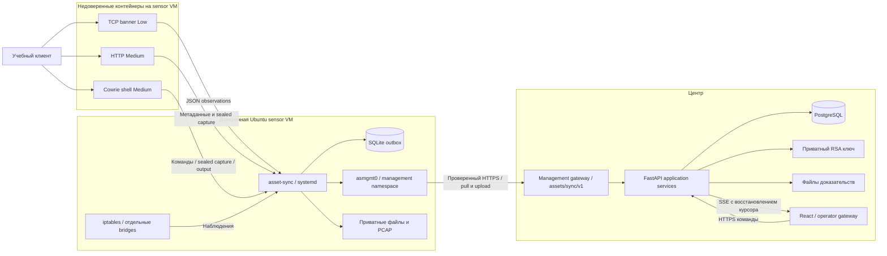
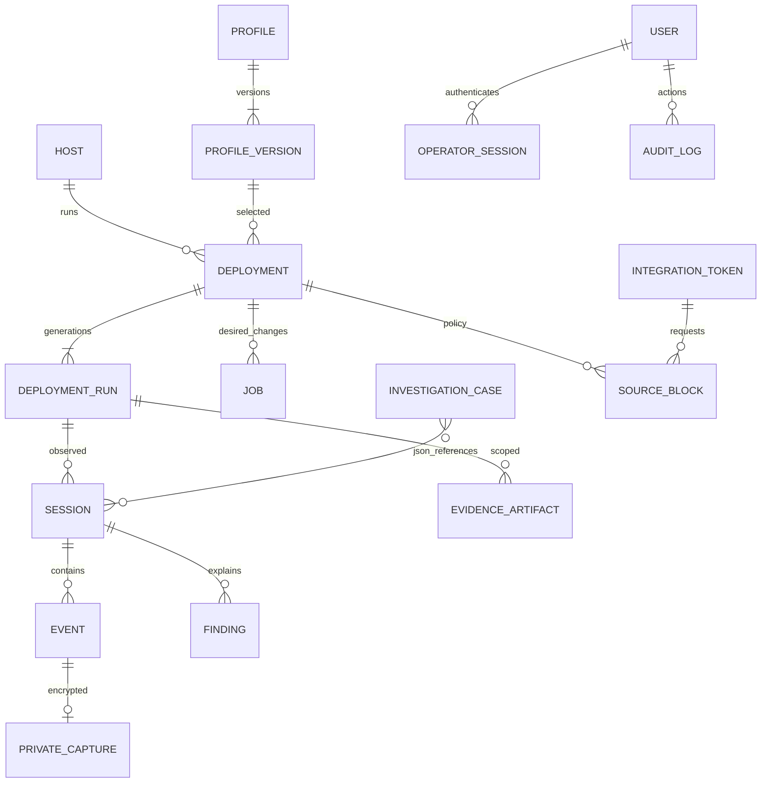
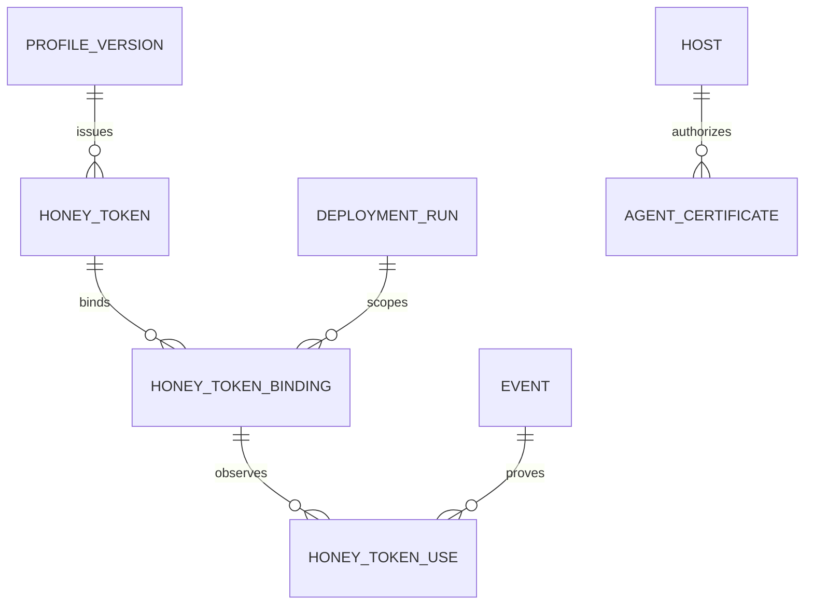

# Архитектура HoneyForge

Модульный монолит управления, отдельный доверенный сенсор и недоверенные приманки.
Продукт анализирует наблюдения правилами. В runtime нет нейросетей или внешних AI API.

## Компоненты и границы доверия

Центр хранит управляющие credentials, приватный ключ расшифровки и аудит. Сенсор
имеет отдельную агентскую identity и доверенный доступ к Docker/iptables. В контейнеры
попадают только параметры эмулируемого сервиса, фиктивные аккаунты и публичный ключ
центра. Docker socket, каталоги агента и operator credentials не монтируются.
Захват root сенсора или гипервизора выходит за принятую модель доверия.

## Разделение приложения

- `domain`: профиль, разрешённые адаптеры, правила наблюдения и политика ролей.
- `application`: ControlService, TelemetryService, InvestigationService, EvidenceService,
  PrivateCaptureService, RetentionService и IntegrationService. HTTP не определяет доменную логику.
- `infrastructure`: PostgreSQL models/repository/unit of work, projections, authentication,
  ключи шифрования, форматы документов и receiver интеграции.
- `api`: маршруты, Pydantic-контракт, зависимости авторизации и преобразование ошибок.
- `agent`: reconcile, leases, outbox, коллекторы, firewall, доказательства и разрешённые адаптеры.
- `sensors`: собственные TCP/HTTP сервисы и интеграция закреплённого Cowrie.
- `apps/web`: React/TypeScript, TanStack Query, Vite, Tailwind и существующие UI-компоненты.
- `packages/contracts`: экспорт OpenAPI и сгенерированные клиентские типы.

Это реализованные каталоги. Один PostgreSQL и один API-процесс упрощают согласованные
транзакции и воспроизведение стенда. Отдельный процесс агента и отдельные сети следуют
границам доверия. Node.js обслуживает сборку интерфейса, Python обслуживает API и сенсор.

## Паттерны и причина выбора

| Решение | Проблема | Реализация | Проверка |
|---|---|---|---|
| Модульный монолит | Слишком много инфраструктуры для одного разработчика | Сервисы по области, общая транзакция/UoW | Backend regression suite |
| CQRS в одном процессе | Запросы UI отличаются от команд управления | application commands и infrastructure queries/projections | Контрактные API-тесты |
| Immutable profile version | Изменение профиля не должно незаметно менять ловушку | version UUID, canonical config hash, explicit redeploy | test_profiles_v2.py |
| Adapter allowlist | Профиль не должен давать исполнить произвольный Docker/shell | Три схемы/образа, фиксированные mounts/ports | foundation.json; masking.json |
| Desired/observed state | HTTP-ответ не доказывает запуск контейнера | jobs, leases, revisions, generation fencing, readiness | live-lab.json |
| Outbox и идемпотентность | Обрыв связи и повторная доставка | SQLite commit перед upload, API ACK после PostgreSQL commit | test_backend.py; live-lab.json |
| SSE с долговечным курсором | Поток UI может оборваться | Стрим хранится в БД, reconnect/replay, explicit reset | test_backend.py; browser evidence |
| Optimistic concurrency | Два окна могут переписать дело или реакцию | revision, stale_revision 409, explicit refresh | test_backend.py; test_retention.py |
| Envelope encryption | Пароль не должен попасть в Docker stdout/outbox | AES-GCM per record, RSA-OAEP wrapped key, AAD scope | foundation.json; test_private_capture.py |
| Двухфазное удаление | Перезапуск между SQL и удалением файла | receiving исключён, purging возобновляется, pins | test_retention.py |

Названия некоторых тестов в таблице обозначают семейство сценариев. Точный состав
смотрите в `tests/`, а результаты живого стенда в `docs/evidence/`.

## Жизненный цикл конфигурации

Профиль v1 читается без переписывания JSON/hash. Новые формы публикуют v2 с явными
service/port/banner/accounts/recording/beacon. Учётки являются приманкой. Порт профиля
рекомендательный, фактический порт относится к deployment. Архив запрещает новые
запуски, сохраняя действующие экземпляры и историю. Удаление занятого профиля даёт 409.

Каждый redeploy создаёт новую generation. Телеметрия, файлы и реакция привязаны
к host/deployment/generation. Повторы delivery принимаются идемпотентно, но не добавляют
новые события. Неизвестный или чужой runtime отклоняется.

## Данные и ER-схема

Связи case/session и finding/evidence реализованы проверяемыми JSON-ссылками, а не
join-table. SQL FK ограничивают основные записи. Case pins сохраняют события и
пересекающиеся PCAP-сегменты. Размеры, hashes и состояние receiving/available/purging/expired
являются частью контракта. Секреты обычные projections не возвращают.

## Запись и конфиденциальность

TCP Low пишет максимум 2 KiB, явно отмечает усечение, ждёт не более 10 секунд и не
исполняет команды. HTTP Medium записывает ограниченный исходный POST payload и
фиктивный логин/пароль. Cowrie Medium пишет реальные вводимые команды, ограниченный
вывод, SFTP и разрешённый fixture download. Успех файла подтверждают bytes и SHA-256.

Чувствительная структурированная запись шифруется до stdout контейнера и SQLite.
Центр проверяет криптографическую связность, а отдельное действие чтения требует
admin/operator/analyst, создаёт аудит и отвечает no-store. Viewer получает 403.

PCAP содержит сырые пакеты и может содержать открытые HTTP-данные. Он является
приватным бинарным доказательством с контролем скачивания и правами файла. Не заявляем
шифрование каждого бинарного доказательства на диске. Backup включает ключи и PCAP:
его необходимо хранить в приватном, защищённом каталоге.

## Сеть и эксплуатация

Операторский и management gateway разделены. Внешний management маршрут
`/assets/sync/v1` переписывается внутрь `/agent/v1`. Корень обычный статический,
Swagger/OpenAPI/internal agent routes снаружи закрыты. TLS проверяет CA и имя сервера.

В двух проверенных VM agent HTTPS socket привязан к `10.88.0.1` и маршрутизируется
через отдельный management namespace, который разрешает только заданный gateway/port.
Порты контейнеров опубликованы только на decoy IP. Снаружи контейнеров правила запрещают
новые соединения к host/management/соседним ловушкам/Internet, оставляя ответный трафик.
Это логическое разделение на одном физическом интерфейсе лаборатории.

Агент хранит приватное состояние в `/var/lib/asset-sync`, служба называется `asset-sync`.
Нейтральное имя дополняет изоляцию и не гарантирует абсолютную нераспознаваемость.
Запросы beacon идут отдельно от быстрой доставки наблюдений. Квоты ограничены и видимы.
События/артефакты хранятся 7 дней, аудит 30 дней, pin дела запрещает автоматическое удаление.

Backup согласованно останавливает API, сохраняет PostgreSQL dump, бинарные доказательства
и приватные ключи. Restore проверяет hashes и пустой независимый target. Реальный restore
подтверждён расшифровкой и скачиванием файла с совпадающим SHA-256.

High требует отдельного Linux/KVM host с Cowrie proxy/backend pool. Эмулятор shell
не выдаётся за настоящую ОС. Отдельные организации используют независимые установки.
Облачный SLA, личность по IP и неограниченную запись локальный стенд не доказывает.

## Дополнительные сервисы и модель данных (миграция 012)

HoneyToken относится к неизменяемой ProfileVersion. Для каждого DeploymentRun выпускается
случайный public marker; Binding фиксирует deployment/generation/resource path. Use имеет
уникальную пару event/binding, каскадное удаление с Event и реальное observed_at. Новые
маркеры появляются только в явно новом запуске. Поздняя доставка сравнивается с временем
отзыва, а не временем получения. Отозванные байты остаются в старом runtime до redeploy.
SSH-команда сама по себе не считается использованием: нужен маркер в наблюдаемом выводе.

DetectionPolicy хранит revision, порог, окно и enabled. Фиксированное окно считается по
observed_at, scope — deployment/source_ip. Finding v2 содержит границы наблюдения и
notification_state=current/historical. Запоздалый исторический всплеск остаётся доступным
для расследования, но не уведомляет как новая атака. Запрос первых threshold событий
поддержан индексом deployment/type/source/observed_at. Изменение policy требует revision.

IoC exporter группирует наблюдаемые IP и SHA-256 только available-файлов правильного
scope. CSV и STIX 2.1 Observed Data включают event IDs, deployments, generations и provenance.
Indicator/атрибуция личности из этого не выводится. maxminddb читает внешние City/ASN файлы
локально; metadata.build_epoch объясняет дату данных. Отсутствие базы не заменяется нулями.

AgentCertificate хранит публичный сертификат, fingerprint, serial, state/expiry/accept_until.
Ключ генерирует сенсор и не передаёт центру. Приватный RSA client CA хранится рядом с ключами
центра и включён в backup. Caddy видит только публичный CA, проверяет client chain и
перезаписывает служебные headers. API проверяет host binding, дату и отзыв на каждом запросе.
При первом CSR допускается enrolled Bearer поверх проверенного server TLS; после первой
активации повторный bootstrap запрещён. Двухфазная ротация переводит старый certificate в
300s overlap только после подтверждения нового TLS-клиента. Durable current/pending pointers
позволяют продолжить с тем же CSR/key после сбоя. HTTP transport замена и in-flight requests
используют общий lock; сбор пакетов/журналов работает независимо. Ошибка certificate не
стирает outbox и не трактуется как отзыв всей host identity.

Правило persona согласует стандартный v2 Ubuntu banner, hostname, uname и os-release.
Произвольный пользовательский banner требует проверки соответствия выбранной легенде;
эмулятор остаётся распознаваемым при достаточно глубоком исследовании. Это не High VM.

## Расширение v3 и High (11 октября)

ProfileVersion schema v3 содержит 2–8 ProfileService; group ссылается на единую immutable
версию. DeploymentGroup → Deployment(service_key) → DeploymentRun → Events/Artifacts.
FK и unique(group_id, service_key) предотвращают дубли. Unit of Work атомарно создаёт
все deployments/reservations/jobs. Idempotency-Key относится ко всей группе. Наблюдаемое
состояние aggregate собирается из дочерних ловушек: partial/failure видны явно.
Изменение topology требует новой группы; redeploy сохраняет ports, исходную историю
и связывает новый generation. Старые config/hash v1/v2 не переписываются.

High: trusted agent → Unix broker → trusted Cowrie proxy → отдельный QEMU guest.
Контейнер прокси имеет только read-only broker mount, гость его не получает.
Per-transport qcow2 overlay + NoCloud seed созданы из проверенного baseline;
cloud-init создаёт hostname/decoy files/file tokens. Virtual network restrict=on
проверяется снаружи гостя; static return route не снимает запрет egress. QEMU non-root,
seccomp, memory/vCPU/disk/session budgets; завершение/recovery удаляют overlay и
точное firewall разрешение. База и ключи центра находятся в другом контуре.
