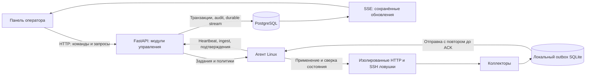

# HoneyForge: цельная концепция продукта и план развития

Дата: 10 октября 2026. Основание: задание на изображении, текущий код, статусы backend/frontend и требования пользователя. Критерии жюри и дедлайн неизвестны. Этот документ фиксирует предлагаемые изменения; он не является отчётом об их реализации.

## Основная идея

**HoneyForge позволяет создать правдоподобную приманку, увидеть действия внутри неё, объяснить обнаружение и подтвердить результат ответного действия.** На защите показываем одну непрерывную историю: конструктор → настоящий удалённый запуск → подключение → живая сессия → finding с доказательствами → ограничение доступа → отчёт.

Продукт работает без нейросетей, внешних AI API и LLM. Аналитика основана на версионированных правилах и ссылках на наблюдавшиеся события. ИИ используется только как инструмент разработки.

## Что уже есть и что предстоит сделать

| Область | Основа в проекте | Следующее изменение |
| --- | --- | --- |
| Конструктор | Две панели, интерактивный локальный preview, редактор файлов, публикация неизменяемых версий | Согласованные легенды и готовые сценарии приманок |
| Развёртывание | Агент Linux, HTTP и Cowrie SSH, задания, статусы, stop/redeploy | Завершить проверку восстановления runtime и видимости ошибок сенсора |
| Наблюдение | Сохранённые события, SSE, сессии, timeline и findings | LIVE-плеер, воспроизведение истории, схема сети |
| Сеть | Изоляция ловушек и счётчики заблокированного исходящего трафика; новый сбор сетевых метаданных в коде | Проверить новый сбор end-to-end, ограничить его ресурсы и отразить качество сбора в UI |
| Ответные действия | Остановка ловушки, отзыв агента | Ограничение источника по IP с TTL, отменой и подтверждением агента |
| Доказательства | Audit и ограниченный JSON-экспорт | Читаемый отчёт расследования и проверяемая канонизация контрольной суммы |

Обновление 10 октября 2026: LIVE/replay-плеер, схема наблюдаемой сети, ограничения источника с TTL/ACK, дела и отчёт реализованы. Новый Cowrie runtime передаёт реальные ограниченные фрагменты вывода `ssh.output`; старые сессии могут содержать только команды. Таблица выше и последовательность ниже сохраняют исходный план развития; актуальные возможности и точные действия описаны в [полном руководстве](USER_GUIDE_RU.md). Доказательства и границы приёмки — в [backend status](BACKEND_STATUS.md) и [frontend status](FRONTEND_STATUS.md).

## 1. Конструктор правдоподобной приманки

Сохраняем текущую компоновку: параметры и файлы слева, интерактивный preview справа. Добавляем три согласованных набора: финансовый портал HTTP, файловое хранилище HTTP и служебный SSH bastion. У каждого имя машины, баннер, назначение, фиктивные файлы и подписи интерфейса рассказывают одну легенду.

Фиктивные файлы содержат только синтетические сведения. Preview обозначен как локальная проверка профиля; его команды не создают события атаки. Публикация создаёт новую версию с config hash. Работающая ловушка показывает точную применённую версию; редактирование профиля не меняет её незаметно.

После публикации пользователь выбирает хост и порт, видит этапы применения и получает endpoint только после подтверждённого запуска. Ошибка содержит причину и доступное действие. Это связывает конструктор с реальным развёртыванием.

## 2. Главный экран: схема сети и наблюдаемая активность

Основной объект — схема **источник → ловушка → хост агента**. Это топология наблюдений, без географических предположений. Слева расположены источники, в центре ловушки, справа хосты. Под схемой — последние активные сессии; выбранная сессия открывает плеер рядом или отдельным экраном.

Новое подключение кратко подсвечивает соответствующую связь. Янтарный означает новую активность, красный — finding соответствующей серьёзности, серый — устаревшее состояние хоста. Подпись объясняет цвет. Анимация прекращается, учитывает reduced motion и не повторяется на каждом пакете.

Клик по узлу фильтрует список, клик по связи открывает относящиеся к ней сессии. При большом числе источников показываем ограниченное число узлов и явную группу остальных; таблица сохраняет полный доступ. Числа на экране имеют определение: уникальные сохранённые события за выбранный период, доступные хосты по heartbeat, deployments в подтверждённом состоянии running.

## 3. Плеер сессии: центральная фича

На экране три области: поток команд, временная шкала, доказательства. В шапке источник, endpoint ловушки, профиль/версия и состояние сбора. У строки есть наблюдавшееся время, тип и ссылка на исходное событие.

**LIVE:** новые сохранённые команды появляются без перезагрузки. Пауза останавливает движение экрана, сбор продолжается. Кнопка «Вернуться в LIVE» загружает пропущенное и возвращает к последней записи. При отключении связи видны reconnecting и время последнего события.

**Replay:** play/pause, скорость ×1/×2/×4, переход по шкале и меткам findings. Выбор finding показывает правило, его версию и события, которые привели к срабатыванию. Воспроизведение использует сохранённую историю и явно подписано как replay.

Первый этап — надёжный плеер команд и событий, которые уже собираются. Следующий — запись ограниченного вывода Cowrie с временными метками, квотами и указанием пропусков. Вывод показываем как текст с очисткой управляющих последовательностей. Он не выполняется в браузере. Пароли остаются маскированными. ОС клиента неизвестна без отдельного подтверждённого источника; результат `uname` относится к эмулируемой среде ловушки.

## 4. Расследование с понятной причиной

Finding отвечает на три вопроса: что наблюдалось, какое правило сработало, какие события служат основанием. Например: «5 неудачных входов за 60 секунд» с пятью ссылками; «команда с намерением загрузки» с конкретной строкой; «исходящие пакеты заблокированы» с источником измерения.

Добавляем дело расследования: выбранные сессии, заметка оператора, статусы «Новое / В работе / Закрыто» и история изменений. Связь по одному IP называется группировкой по источнику; она не доказывает общую личность. Агрегированные firewall-счётчики не выдаём за число уникальных соединений или известные адреса назначения.

## 5. Ограничение источника с доказуемым результатом

Действие называется **«Заблокировать источник для ловушки»**. Перед применением видны IP, область действия, срок и причина. Для демонстрации удобно выбрать 60 секунд. Доступна отмена. Это ограничение доступа к выбранной приманке, а не изоляция чужой машины.

Backend сохраняет политику и аудит. Агент применяет её только к принадлежащему HoneyForge сетевому пути ловушки и возвращает подтверждение. UI различает «Ожидает применения», «Подтверждено агентом», «Ошибка», «Состояние неизвестно», «Отменено», «Срок истёк». Offline-хост не даёт зелёного подтверждения.

Политика содержит нормализованный IP, deployment/runtime scope, revision и абсолютный expires_at. Агент восстанавливает политики после перезапуска и самостоятельно снимает просроченные, даже без связи с сервером. Защищённые адреса управления не допускаются. Управление не принимает произвольные shell-команды.

Первый поддерживаемый результат — запрет новых подключений. Если потребуется оборвать существующую SSH-сессию, это отдельная возможность с собственным исполнителем и проверкой; UI обещает её только после реализации. Проверка: заблокированный источник не подключается, второй источник продолжает работать, API управления доступен, после истечения срока подключение восстанавливается.

## 6. Отчёт для оператора и защиты

Отчёт собирается из данных: параметры и версия приманки, интервал наблюдения, источник, хронология, findings с evidence, ответные действия, подтверждения агента и ограничения сбора. Добавляем читабельную страницу с печатью в PDF через браузер и JSON для машинной проверки.

Контрольная сумма считается по каноническому JSON с явно заданными правилами сериализации и исключённым полем самой суммы. Проверка пересчитывает её из фактически полученного ответа, включая формат UTC. SHA-256 подтверждает совпадение содержимого; это не цифровая подпись и не доказательство авторства.

## Архитектура и причины решений

| Решение | Зачем | Граница и компромисс |
| --- | --- | --- |
| Модульный монолит FastAPI | Один исполнитель, единые транзакции, простое развёртывание | Доменные правила, application services и адаптеры отделяем; текущие services используют ORM, полная hexagonal architecture не заявляется |
| Неизменяемые ProfileVersion и DeploymentRun | Воспроизвести, что именно видел источник | Изменение профиля требует новой версии и явного применения |
| Unit of Work | Состояние, audit и сообщение потока фиксируются атомарно | Проверяем rollback и не публикуем неподтверждённые изменения |
| Desired/observed state и reconciliation | Сбой агента не превращается в ложный успех UI | Состояние unknown остаётся видимым до свежего подтверждения |
| Strategy для runtime/collectors | HTTP и Cowrie имеют разные настройки и события | Поддерживаются фиксированные адаптеры; произвольные образы и команды не открываются оператору |
| SQLite outbox + ACK + idempotency | Пережить временное отключение управления | Доставка с повторами, сервер подавляет дубликаты; квота и потери показываются явно |
| SSE с durable cursor | Доставка обновлений от сервера в браузер, восстановление после разрыва | SSE несёт IDs; данные читаются из API. Двусторонние действия идут через HTTP |
| Read projections | Схема сети, плеер и отчёт читают согласованные данные | Пределы выборки, pagination и truncation указаны; метрики не считаются из текущего видимого списка |
| Версионированные правила с evidence | Объяснить обнаружение на защите | Вывод ограничен наблюдаемыми фактами и указанным правилом |
| Отдельный модуль политик ответа | TTL, отмена, ACK и восстановление не смешиваются с deploy | Новые типизированные команды; текущий обработчик результатов deploy не переиспользуется без изменения контракта |

SSE поддерживает идентификаторы и восстановление потока; он подходит для этого направления данных. [MDN: Server-sent events](https://developer.mozilla.org/en-US/docs/Web/API/Server-sent_events/Using_server-sent_events).

Cowrie поддерживает эмуляцию shell и replay журналов, однако наш адаптер должен отдельно подключить сбор вывода. High interaction требует реального backend-окружения и отдельной изоляции. [Документация Cowrie](https://docs.cowrie.org/en/latest/README.html).

Применение сетевых политик учитывает цепочки Docker и конкретный backend firewall; поддерживаемый вариант проверяется на Linux-сенсоре. [Docker: packet filtering and firewalls](https://docs.docker.com/engine/network/packet-filtering-firewalls/).

## Контракты следующих изменений

Это предлагаемые дополнения, а не уже существующие endpoints. Перед кодом фиксируем их в OpenAPI и генерируем типы frontend.

* Снимок топологии: host/deployment/source nodes, связи, выбранный период, watermark и ограничения выборки.
* История плеера: session ID, event ID, runtime generation, observed_at/received_at, стабильный порядок и cursor. Snapshot и продолжение должны исключать разрыв между чтением истории и подпиской.
* Политика блокировки: создание с idempotency key, получение статуса, отмена с revision; отдельные доставка агенту и ACK фактического применения.
* Дело: выбранные session IDs, заметка, состояние, audit. Отчёт строится из сохранённых фактов и выбранной версии представления.

В UI используем существующие React/TypeScript и общий SSE-провайдер. Локальное состояние воспроизведения отделено от серверного кэша. Pause/replay не меняют сбор и серверные данные. Установка другой библиотеки графиков требуется только при конкретной необходимости.

## UI: референсы Mobbin и собственный характер

| Экран | Просмотренный источник | Применяемый паттерн |
| --- | --- | --- |
| Плеер сессии | [Sentry replay player](https://mobbin.com/screens/fb3bd6e9-4ad2-4bec-a581-946e7eb7b53f) | Большая область воспроизведения, события справа, нижняя временная шкала и управление скоростью |
| Схема сети | [Cloudflare resource bindings](https://mobbin.com/screens/fa011061-0438-45b8-9371-caa44424b211) | Связи ресурса с соседними сущностями и переход к подробностям; исходник показывает Worker, не карту атак |
| Список ограничений | [Square Block List](https://mobbin.com/screens/520d7360-b95f-4936-9ea2-bb52c929e16d) | Кто добавил, когда, какой идентификатор и причина; TTL и ACK — собственные требования HoneyForge |

Сохраняем узнаваемый конструктор и действующие компоненты. Для плеера и презентационного режима — графитовый фон, янтарный акцент, моноширинные команды, красный для серьёзного finding. Цвета берём из общей системы токенов. Большие пустые декоративные графики не добавляем: каждому блоку соответствует действие или измерение.

## Порядок реализации и критерии приёмки

Все цифры ниже — целевые критерии, их достижение пока не заявляется. Продолжительность этапов зависит от результатов проверок; обещание закончить всё за неизвестный срок не делается.

| Этап | Действия | Проверка результата и доказательство |
| --- | --- | --- |
| A0. Надёжность основы | Проверить новый сбор сети, лимиты памяти/буферов, восстановление runtime, snapshot/reconnect SSE и канонизацию экспорта | Отчёт испытаний: 60 секунд потери связи без потери событий в пределах квоты; 100 повторных event IDs без дублей; restart сенсора; сумма пересчитана клиентом |
| A1. Плеер команд | Cursor API, LIVE/pause/catch-up, replay, timeline, переход к evidence | Два окна: настоящая SSH-команда видна в панели; цель p95 ≤2 с при 10 событиях/с; пауза не теряет записи; длинные строки и ANSI безопасны |
| A2. Схема сети | Проекция узлов и связей, общие фильтры, ограничение числа узлов, состояния offline | Настоящее подключение подсвечивает правильную ловушку; клик открывает правильную сессию; stale heartbeat не выглядит healthy |
| A3. Ограничения | Модель политики, типизированная доставка/ACK, TTL/отмена/reconciliation, UI | Запрет нового подключения из выбранного источника; второй источник и управление доступны; отмена/TTL/restart/offline проверены; audit связывает запрос и результат |
| A4. Дело и отчёт | Заметки и состояния, связи с evidence, печатное представление, JSON | Один finding воспроизводится из конкретных событий; экспорт и экран согласованы, обрезка видна, контрольная сумма проверяется |
| A5. Вывод терминала | Ограниченный сбор output с timing, безопасный viewer и метки пропусков | Replay воспроизводит ввод и сохранённый вывод; переполнение квоты обозначено; HTML и управляющие последовательности не воздействуют на UI |
| A6. Расширение | Второй хост, откат версии, дополнительные реальные адаптеры; high interaction при необходимости задания | Каждый адаптер имеет реальный запуск, нормализованные события, cleanup и демонстрируемую изоляцию |

Для каждого этапа сохраняем: проблему, решение и причину; изменённые контракты; выполненные проверки; ограничения; скриншот или короткую запись демонстрации. Это готовый материал для ответов жюри «что сделали и почему».

## Защита за три минуты

1. **0:00–0:30 — приманка.** Показать готовую легенду, синтетический файл, версию и running на настоящем Linux-сенсоре. Не ждать установку зависимостей во время защиты.
2. **0:30–1:15 — подключение.** Во втором окне подключиться по SSH к опубликованному endpoint; в панели подсветить связь и открыть LIVE-сессию.
3. **1:15–2:00 — действия и объяснение.** Ввести `whoami`, `uname -a`, `cat /home/admin/backup-notes.txt`. Показать событие, finding и его evidence. Команда чтения сама по себе не объявляется доказанным вредоносным действием.
4. **2:00–2:30 — ответ.** Ограничить источник на 60 секунд, дождаться ACK, показать отказ нового подключения. При unknown честно показать отсутствие подтверждения.
5. **2:30–3:00 — результат.** Открыть отчёт с версией приманки, хронологией, правилом и подтверждённым действием.

Дополнительная сцена при вопросах: кратко отключить канал агента к управлению, выполнить действие в ловушке и восстановить связь. Показать доставку накопленных событий без дублей и различие observed/received time. Эту сцену показываем после отдельной приёмки A0.

На случай сбоя подготовить сохранённую запись реальной демонстрации и replay той же сессии. Они явно подписаны как запись. Успешная защита опирается на воспроизводимый сценарий; победа зависит также от критериев и других команд.
